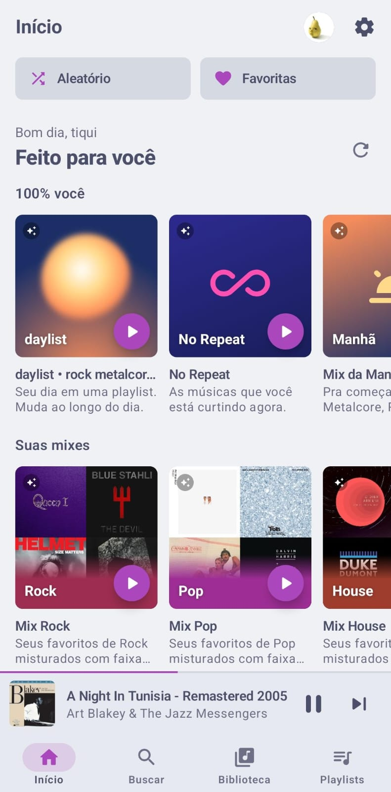
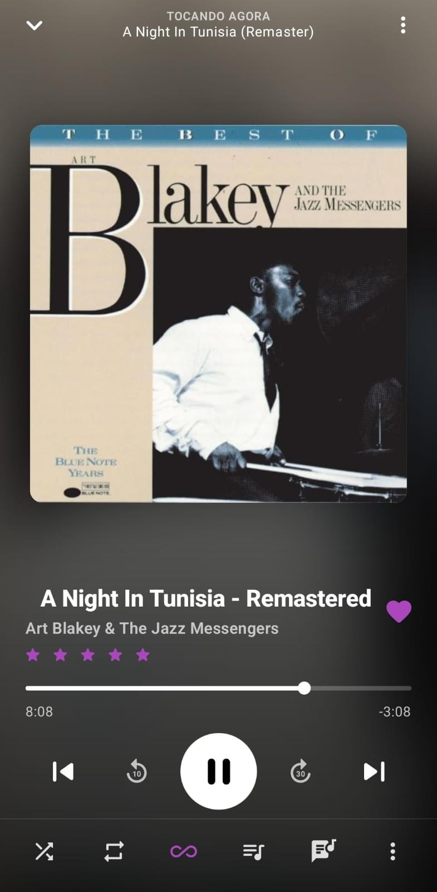
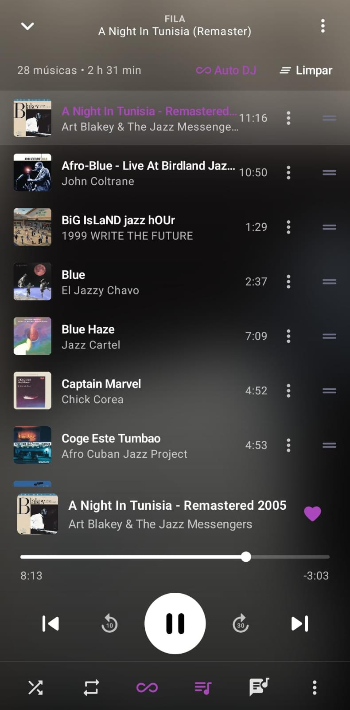
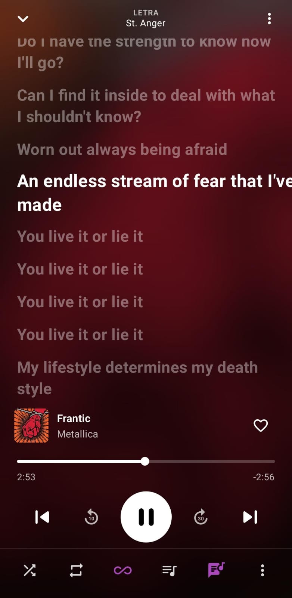
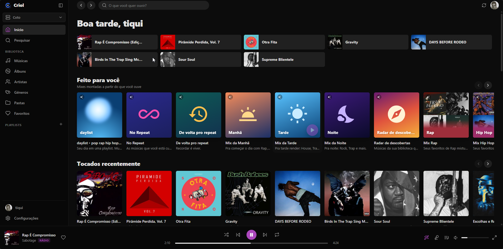
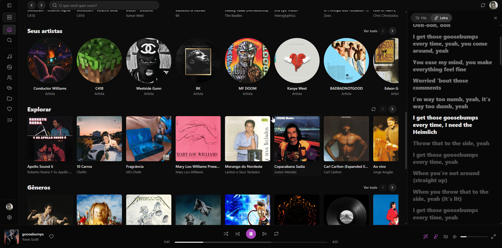
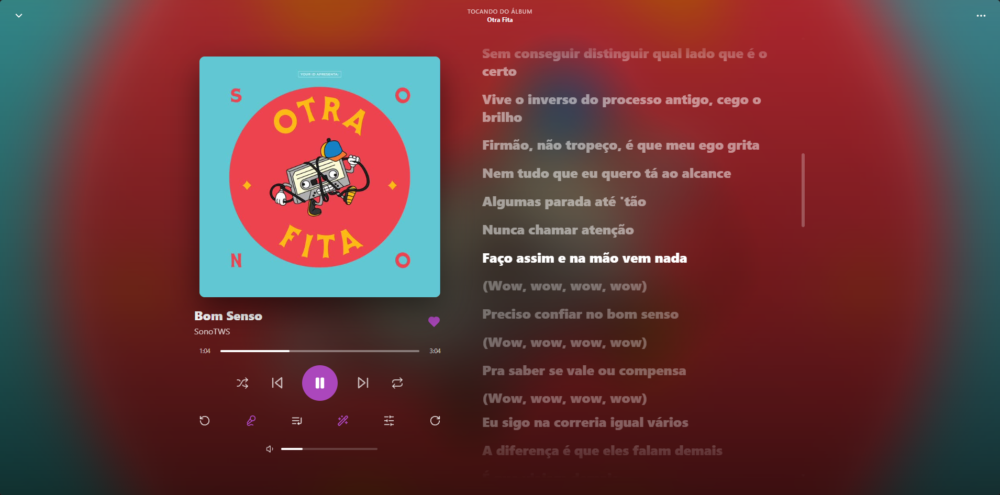
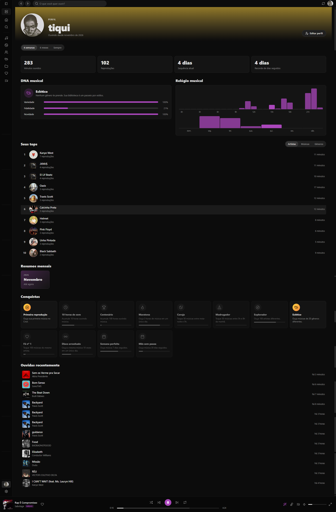

# Criol

Player de música com perfil, mixes automáticas, letras sincronizadas e resumo mensal do que
você ouviu. Tem duas versões, com a mesma biblioteca, o mesmo perfil e as mesmas mixes:

- **Android** ([`android/`](android)): toca as músicas das pastas do celular.
- **Desktop e web** ([`desktop/`](desktop)): Windows, Linux, macOS e navegador. Toca músicas de
  pastas do computador e de servidores **Navidrome/Subsonic** e **Jellyfin**.

## Como é

### Android

<table>
  <tr>
    <td width="25%"></td>
    <td width="25%"></td>
    <td width="25%"></td>
    <td width="25%"></td>
  </tr>
  <tr>
    <td><b>Início</b>: daylist, No Repeat, mixes do período e por gênero.</td>
    <td><b>Tocando agora</b>: capa, favorito, estrelas e os botões de voltar/avançar segundos.</td>
    <td><b>Fila</b>: arrastar para reordenar e o Auto DJ completando a fila.</td>
    <td><b>Letra</b>: sincronizada, sobre a cor da capa.</td>
  </tr>
</table>

### Desktop e web

**Início**: atalhos para o que você ouviu por último, as mixes do Feito para você e os tocados
recentemente.



**Letra ao lado**: a letra sincronizada abre num painel à direita, junto com a fila, sem sair da
tela em que você está.



**Tocando agora**: tela cheia com a capa, os controles e a letra, sobre um fundo feito da própria
capa desfocada.



**Perfil**: minutos ouvidos, sequência de dias, DNA musical, relógio musical, tops, resumos
mensais, conquistas e o que você ouviu por último.



## Baixar

Os instaladores do desktop ficam na [página de releases](https://github.com/tiqui/Criol/releases):

| Sistema | Arquivo |
| ------- | ------- |
| Windows | `Criol-<versão>-win-x64.exe` (instalador) ou `.zip` |
| Linux   | `.AppImage`, `.deb` ou `.tar.xz` |
| macOS   | `.dmg` (Apple Silicon e Intel) |

Os instaladores não são assinados. No Windows, clique em **Mais informações → Executar assim
mesmo** na primeira vez; no macOS, abra com o botão direito → **Abrir**.

O app Android é compilado pelo Android Studio (veja [`android/README.md`](android/README.md)).

## Versão web (Docker)

```yaml
services:
    criol:
        image: ghcr.io/tiqui/criol:latest
        restart: unless-stopped
        ports:
            - 9180:9180
        environment:
            - CRIOL_SERVER_URL=https://navidrome.exemplo.com # opcional
            - CRIOL_SERVER_FALLBACK_URL=http://100.64.0.1:4533 # opcional: outro endereço do mesmo servidor
            - CRIOL_SERVER_TYPE=navidrome # navidrome, subsonic ou jellyfin
            - CRIOL_SERVER_NAME=Minha música # opcional
            - CRIOL_SERVER_LOCK=false # true: só deixa usar esse servidor
```

Abra `http://localhost:9180`. As variáveis são opcionais: sem elas, o Criol pergunta o servidor
no primeiro acesso. Na web, a pasta local funciona no Chrome e no Edge (o navegador pede
permissão para ler a pasta).

## O que tem

- **Biblioteca**: músicas, álbuns, artistas, gêneros, pastas, playlists e favoritos, com busca
  que ignora acentos.
- **Player**: fila com reordenação por arraste, aleatório, repetir, velocidade, timer de sono e
  controles do sistema. A fila e a posição voltam ao abrir o app.
- **Letras sincronizadas**: do arquivo `.lrc`, da tag, de pastas de letras e, no desktop, do
  servidor e do LRCLIB.
- **Feito para você**: daylist, Mix da Manhã/Tarde/Noite, No Repeat, De volta pro repeat, Radar de
  descobertas e mixes por gênero.
- **Rádio da música** e **Auto DJ**.
- **Perfil**: minutos ouvidos, sequência de dias, DNA musical, relógio musical, tops, conquistas
  e **resumo mensal**.
- **Aparência**: 16 temas e cor de destaque.
- **Servidor com dois endereços** (desktop e web): um principal e um alternativo, por exemplo o IP
  da rede local e o do Tailscale. Se um não responde, o Criol usa o outro sozinho.

O histórico de escuta exportado de uma versão pode ser importado na outra.

## Estrutura

- [`desktop/`](desktop): Electron + React + TypeScript. Como rodar e compilar está no
  [`desktop/README.md`](desktop/README.md).
- [`android/`](android): Kotlin + Jetpack Compose.

## Licença

[MIT](LICENSE).
